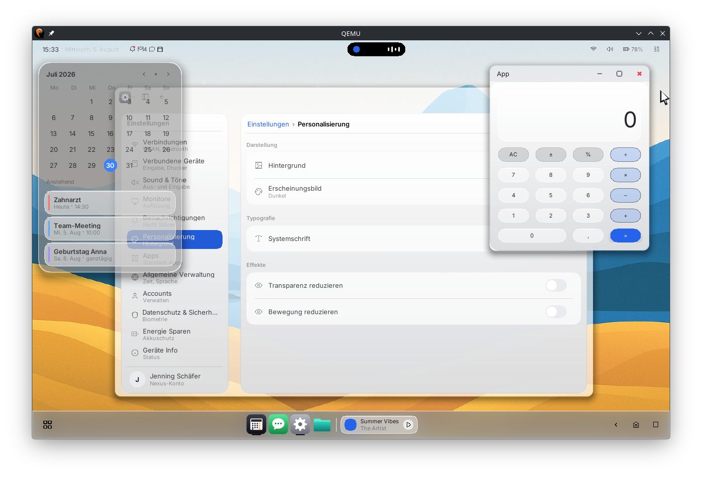

# Open Nexus OS — an independent, capability-based operating system for RISC-V, written in Rust

**Open Nexus OS is an independent, capability-based operating system for RISC-V,
from microkernel to desktop. It is early-stage: it boots to a graphical desktop
in QEMU and on real RISC-V hardware, but it is not yet a daily driver.**

The `neuron` microkernel keeps only scheduling, virtual memory, IPC and
capabilities. Everything else — drivers, filesystem, networking, the window
system — runs as userspace services under deny-by-default capability policy.

[](https://doi.org/10.5281/zenodo.18934993)
[](https://github.com/open-nexus-OS/open-nexus-OS/discussions)
[](https://github.com/sponsors/open-nexus-OS)

<p align="center">
  
</p>
<p align="center">
  <sub>The desktop on RISC‑V — <code>windowd</code> compositor, <code>gpud</code> GPU backend, and DSL apps (settings, calendar, calculator) on the app-host.</sub>
</p>

## Why Open Nexus

- **Rust from kernel to apps.** Kernel, drivers, services and the desktop are
  written in Rust; userspace crates carry `#![forbid(unsafe_code)]`.
- **Drivers live in userspace.** A crashing driver, filesystem or compositor
  fails as a service, not as the kernel.
- **No ambient authority.** A service can only touch what it holds a capability
  for. Identity comes from the kernel, never from a string a caller can forge.
- **Its own desktop.** A compositor service, a GPU backend and a declarative
  `.nx` app platform — not a Linux derivative.
- **Runs on real hardware.** A RISC-V single-board computer boots it from eMMC
  to a 1080p desktop driven by a USB keyboard and mouse.

## At a glance

| | |
| --- | --- |
| **Status** | Early-stage. Boots to a usable desktop; not yet a daily driver. |
| **Kernel** | `neuron` — a capability microkernel in Rust (`no_std`): scheduling, virtual memory, IPC, capabilities. Drivers and policy stay out of it. |
| **Architecture** | RISC-V 64-bit (`riscv64imac-unknown-none-elf`), SMP=4 by default |
| **Runs on** | `qemu-system-riscv64 virt` (virtio-gpu 2D, virgl 3D) and one RISC-V single-board computer (eMMC boot, HDMI 1080p60, USB input) |
| **Security model** | Capability-based, deny-by-default; identity is the kernel-provided `sender_service_id`, never payload strings |
| **Desktop / GUI** | `windowd` compositor service + `gpud` GPU backend + a declarative `.nx` app platform |
| **License** | Apache-2.0 — see [LICENSE](LICENSE); third-party notices in [THIRD_PARTY_NOTICES](THIRD_PARTY_NOTICES) |

## Quickstart

Supported hosts: **Debian/Ubuntu, Fedora and Arch** (and their derivatives).
The only prerequisites are `git`, `curl` and `make`:

```sh
sudo apt install -y git curl make          # Debian/Ubuntu
sudo dnf install -y git curl make          # Fedora
sudo pacman -S --needed git curl make      # Arch
```

Clone under `$HOME` and let one command install and verify everything else.
Run it as yourself, not with `sudo` — it asks for your password when it needs it.

```sh
git clone https://github.com/open-nexus-OS/open-nexus-OS.git ~/open-nexus-OS
cd ~/open-nexus-OS
make initial-setup          # toolchain, QEMU, build inputs — then `make doctor`
```

Then boot it:

```sh
just start                  # build + launch the desktop in a QEMU window
make build && make run      # or: one bounded headless boot
```

Setup flags, `make doctor`, the `just`/`make` entrypoints and the verification
ladder are in [CONTRIBUTING.md](CONTRIBUTING.md).

## Current state

The system boots to an interactive graphical desktop in QEMU RISC-V and on a
real RISC-V board. Every feature below is regression-gated by deterministic
QEMU marker proofs:

- **UI stack**: `windowd` compositor service + `gpud` (virtio-gpu 2D, virgl 3D,
  and the board's own GPU) + a declarative DSL app platform — apps are `.nx`
  files run by the app-host (launcher, settings, file manager, chat,
  calculator, ...).
- **Hardware**: the board boots from eMMC through its stock boot chain, drives
  HDMI at 1920x1080@60 through the SoC's display controller and takes USB
  keyboard and mouse input. Its proof ladder is `just board-test`
  (see `docs/board/`).
- **SMP**: soft-realtime SMP=4 is the interactive default (declarative CPU
  placement, phased/lock-free syscall classes).
- **Storage**: nxfs + VFS v2 provide persistent user-data storage (`svc.files`,
  cold-boot persistence proofs).
- **Networking**: DSoftBus with stream mux and a Noise XK handshake. Session
  establishment and transport selection are proven host-first and in single-VM
  QEMU (`ci-os-dhcp` green); real QUIC (quinn/rustls) exists on the host
  transport path, while the in-OS transport is currently a Noise-authenticated
  UDP datagram facade. The 2-VM cross-device harness exists but its discovery
  lane is currently failing — see `tasks/TRACK-NETWORK-PROOF-LANES.md`.

Day-to-day status (open tasks, tracks, blockers) lives in `tasks/STATUS-BOARD.md`.

## FAQ

### Is this a real operating system, or a kernel study?

It is a full OS image: the `neuron` microkernel plus a userland of services and
drivers that boots to a graphical desktop. It is **early-stage**, though —
every lane proves it on `qemu-system-riscv64 virt`, real hardware is one RISC-V
board so far, and it is not a distribution you would install as a daily driver.

### Why a microkernel written in Rust for RISC-V?

The kernel holds only scheduling, virtual memory, IPC and capabilities, so
drivers, filesystems and the window system can fail without taking the system
down. Rust removes the memory-safety class of bugs from that userspace; RISC-V
gives an open, well-specified target where the whole boot path — firmware,
kernel, services — is inspectable.

### What does "capability-based" mean in this OS?

There are no ambient rights. A service can only touch what it holds a capability
for, policy is deny-by-default, and identity is the kernel-provided
`sender_service_id` on an IPC channel rather than anything a caller can put in a
payload. See `docs/architecture/11-policyd-and-policy-flow.md`.

### Does the RISC-V desktop run on real hardware?

Yes, as of 2026-10: a RISC-V single-board computer boots the OS from its eMMC
through the stock boot chain, shows the desktop at 1920x1080@60 (from the CEA
timing table — reading the monitor's EDID follows with the GPU work) on its
HDMI output through the SoC's display controller, and a USB keyboard and mouse
drive it (the pointer rides the controller's own hardware layer). The board
ladder (`just board-test`, `docs/board/`) proves it. The proof target for every
lane is still QEMU `virt` with virtio devices; the board added drivers and SoC
glue, not a new kernel.

### How does it relate to other RISC-V operating systems?

It sits in the capability-microkernel family rather than the monolithic one: a
small kernel, everything else in userspace, capabilities as the only authority.
It is not a Linux derivative — no Linux drivers, no X11, no Wayland; the
graphics path is this project's own compositor service.

## Contributing

- **Start here**: [CONTRIBUTING.md](CONTRIBUTING.md) — setup, verification
  ladder, how decisions are made, PR conventions.
- **Questions and ideas**: [GitHub Discussions](https://github.com/open-nexus-OS/open-nexus-OS/discussions)
  or [Discord](https://discord.gg/3sTZvH4PEq). Updates on
  [Mastodon](https://mastodon.social/@open_nexus_os) and
  [YouTube](https://www.youtube.com/@opennexusOS).
- **First issues**: look for the
  [`good first issue`](https://github.com/open-nexus-OS/open-nexus-OS/labels/good%20first%20issue) label.
- **Security policy**: [SECURITY.md](SECURITY.md) ·
  **Code of conduct**: [CODE_OF_CONDUCT.md](CODE_OF_CONDUCT.md)

Work is tracked in task ledgers (`tasks/TASK-*.md`, the execution truth),
design contracts (`docs/rfcs/`) and architecture decisions (`docs/adr/`).

## Documentation

- **Overview and layout**: `docs/README.md`
- **Architecture** (start here for the design): `docs/architecture/README.md`
- **Testing (host-first, QEMU-last)**: `docs/testing/README.md`
- **Security** — policy authority and audit: `docs/security/signing-and-policy.md`,
  `docs/rfcs/RFC-0015-policy-authority-audit-baseline-v1.md`; device identity
  keys (virtio-rng → `rngd` → `keystored`): `docs/security/identity-and-sessions.md`
- **Updates** — userspace A/B update skeleton: `docs/packaging/ab-updates-skeleton-v1.md`
- **Observability** — logd journal and crash reports: `docs/observability/logging.md`
- **Standards** — headers, ownership, drift rules: `docs/standards/DOCUMENTATION_STANDARDS.md`
- **CI**: `.github/workflows/ci.yml` wraps the canonical `just` recipes;
  `cla-check.yml` checks the CLA on pull requests (`.github/CLA.md`).

## Citation

If you reference Open Nexus OS or its architecture, please cite the software
record and the related architecture series. The records below are
self-archived preprints deposited on Zenodo; none of them has been peer
reviewed.

- Software DOI: [10.5281/zenodo.18934993](https://doi.org/10.5281/zenodo.18934993)
- Part I, Type-Driven Deterministic Construction of a Capability Microkernel: [10.5281/zenodo.18935402](https://doi.org/10.5281/zenodo.18935402)
- Part II, Bounded Control-Plane IPC and Explicit Bulk Data Paths: [10.5281/zenodo.18935755](https://doi.org/10.5281/zenodo.18935755)
- Part III, Service Planes and a Capability-Governed Mesh: [10.5281/zenodo.18938789](https://doi.org/10.5281/zenodo.18938789)
- Part IV, Userspace Device Services Substrate: [10.5281/zenodo.18939217](https://doi.org/10.5281/zenodo.18939217)
- Contract-Governed LLM Development: [10.5281/zenodo.18941284](https://doi.org/10.5281/zenodo.18941284)
